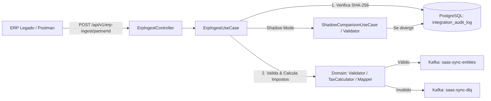

# MIS ERP Integration Hub — Guia Prático de Engenharia & Operação

> **Bem-vindo(a) ao time de MIS (Managed Integration Services)!**  
> Este repositório é o seu laboratório prático para dominar o dia a dia de uma equipe que conecta **ERPs legados de distribuidores externos** a uma **plataforma SaaS B2B central** usando arquitetura orientada a eventos, Java 21, Spring Boot 3.4, Kafka, PostgreSQL, OpenTelemetry, Testcontainers e PITest.

---

## 1. Conceitos Fundamentais (O "Porquê" Antes do Código)

Antes de rodar qualquer comando, entenda os 6 pilares que sustentam uma integração B2B 24/7:

1. **Extract → Transform & Validate → Deliver (ETL Orientado a Eventos):**  
   ERPs legados enviam dados "sujos" (SKUs em minúsculo com espaços, impostos separados como ICMS/IPI/ST, timestamps inválidos, campos obrigatórios nulos). Nosso hub **nunca** repassa lixo para o SaaS: ele valida, calcula o preço final, normaliza para um **Contrato Canônico** (`CanonicalSyncEvent`) e só então publica no Kafka.
2. **Arquitetura Hexagonal Pragmática:**  
   A camada `domain` é **100% Java puro** (zero `@Autowired`, zero JPA, zero Kafka). Isso permite testar regras tributárias e validações em milissegundos e atingir **>95% no PITest**.
3. **Idempotência Determinística (SHA-256 + PostgreSQL):**  
   ERPs frequentemente reenviam o mesmo lote por timeout ou retry. Calculamos um hash SHA-256 do payload (`PayloadHashService`) e gravamos com `UNIQUE (partner_id, payload_hash)` no PostgreSQL. Se chegar repetido, retornamos `200 OK (DUPLICATE)` sem duplicar evento no Kafka.
4. **Resiliência: Retry Exponencial vs. DLQ Imediata:**  
   - **Erro de infraestrutura** (broker Kafka instável): tentamos novamente com backoff exponencial (`200ms → 400ms → 800ms`). Se esgotar, cai na `saas-sync-dlq`.
   - **Erro de negócio** (SKU nulo, preço `<= 0`, sem `accountId`/`deliveryCenterId`): **não** faz sentido dar retry (o dado não vai se consertar sozinho). Vai direto para `saas-sync-dlq` com o motivo exato gravado na auditoria.
5. **Shadow Migration (Parallel Run):**  
   Antes de desligar um adaptador legado (cutover), rodamos o novo motor MIS em paralelo. O `ShadowMigrationValidator` compara 100% dos campos críticos e registra qualquer divergência como `SHADOW_DIFF` para zerar riscos antes da virada.
6. **Observabilidade Ponta a Ponta (`traceId`):**  
   Cada requisição nasce com um `traceId` (OpenTelemetry/Micrometer), que vai para os logs JSON, para a tabela `integration_audit_log` no Postgres e para o header `X-Trace-Id` das mensagens Kafka.

---

## 2. Arquitetura e Mapa de Arquivos Importantes



### Onde mora cada responsabilidade:
- **Entrada REST (`api/`):**
  - `ErpIngestController.java` — `POST /api/v1/erp-ingest/{partnerId}`
  - `ShadowMigrationController.java` — `POST /api/v1/shadow/compare/{partnerId}`
  - `AuditQueryController.java` — `GET /api/v1/audit/trace/{traceId}`
  - `LegacyErpIngestRequest.java` — DTO permissivo para aceitar dados sujos sem quebrar antes da auditoria.
- **Orquestração (`application/`):**
  - `ErpIngestUseCase.java` — Fluxo principal (hash → idempotência → domínio → auditoria → Kafka/DLQ).
  - `ShadowComparisonUseCase.java` — Orquestra o parallel run e grava `SHADOW_DIFF`.
  - `PayloadHashService.java` — Gera SHA-256 determinístico.
- **Domínio Puro (`domain/`):**
  - `CanonicalSyncEvent.java` — Contrato oficial publicado para o SaaS.
  - `ErpPayloadValidator.java` — Regras obrigatórias de negócio.
  - `TaxCalculator.java` — Cálculo de ICMS + IPI + ST usando `BigDecimal` (`RoundingMode.HALF_UP`).
  - `ErpToCanonicalMapper.java` — Normalização e construção do evento canônico.
  - `ShadowMigrationValidator.java` — Motor de comparação 100% dos campos críticos.
- **Infraestrutura (`infrastructure/` & `resources/`):**
  - `V1__create_integration_audit_log.sql` — Migration Flyway da tabela de auditoria/idempotência.
  - `PostgresAuditAdapter.java` — Persistência JPA no PostgreSQL.
  - `KafkaEventPublisherAdapter.java` — Producer com retry exponencial, headers `X-Trace-Id` e roteamento DLQ.
  - `logback-spring.xml` — Logs estruturados em JSON com `traceId`, `spanId` e `partnerId`.
- **Workflow AI-Ready:**
  - `.cursorrules` e `.agent/rules/mis-architecture.md` — Regras arquiteturais para assistentes de IA.
  - `.agent/skills/diagnose-dlq/SKILL.md` — Playbook de diagnóstico de falhas.

---

## 3. Passo a Passo: Subindo o Ambiente Local

### Pré-requisitos
- Java 21 (`java -version`)
- Maven 3.9+ (`mvn -version`)
- Docker + Docker Compose (`docker --version`)

### Passo 1 — Subir a Infraestrutura (Postgres, Kafka, Kafka UI, Jaeger)
Na raiz do projeto (`C:\Users\rodri\Dev\workspace\workspace-mis-integration`):
```powershell
docker compose up -d
docker compose ps
```
> **Atenção:** Se você já tiver outro Postgres rodando na porta `5432` ou outro serviço na `8081`, pare-os antes ou ajuste as portas no `docker-compose.yml`.

Portas disponíveis após subir:
- **PostgreSQL:** `localhost:5432` (`db: mis_integration`, `user: mis_user`, `pass: mis_pass`)
- **Kafka Broker:** `localhost:9092`
- **Kafka UI:** http://localhost:8081
- **Jaeger UI (Traces):** http://localhost:16686

### Passo 2 — Subir a Aplicação Spring Boot
```powershell
mvn spring-boot:run
```
Verifique se subiu saudável:
```powershell
curl.exe http://localhost:8080/actuator/health
```
Esperado: `{"status":"UP"}`.

---

## 4. Laboratório Prático (Executando os Cenários na Mão)

Use os comandos abaixo em outro terminal PowerShell (com `curl.exe`) e **observe os logs da aplicação ao mesmo tempo**.

### Cenário 1: Ingestão Válida (`202 Accepted` → `saas-sync-entities`)
```powershell
curl.exe -i -X POST http://localhost:8080/api/v1/erp-ingest/dist-alpha `
  -H "Content-Type: application/json" `
  -d '{
    "batchId": "batch-001",
    "sku": "  sku-cerv-600 ",
    "productDescription": "Cerveja Pilsen 600ml",
    "unitPrice": 100.00,
    "icmsRatePercent": 18.0,
    "ipiRatePercent": 5.0,
    "stFixedAmount": 2.00,
    "stockQuantity": 50,
    "accountId": "acc-varejo-01",
    "deliveryCenterId": "dc-sp-02",
    "erpUpdatedAt": "2026-11-20T10:00:00Z"
  }'
```
- **O que observar:**
  - HTTP `202 Accepted` com `"status":"PUBLISHED"` e um `traceId`.
  - **Guarde esse `traceId`!**
  - No **Kafka UI** (`http://localhost:8081`), abra o tópico `saas-sync-entities`: você verá o `sku` normalizado (`SKU-CERV-600`), `finalPrice: 125.00` e o header `X-Trace-Id`.

### Cenário 2: Testando Idempotência (Reenvio do Mesmo Lote)
Rode **exatamente o mesmo comando** do Cenário 1 novamente:
- **O que observar:**
  - HTTP `200 OK` com `"status":"DUPLICATE"` e `"message":"Payload already processed under traceId=..."`.
  - **Nenhuma nova mensagem** é publicada no Kafka! O banco barrou a duplicata pelo hash SHA-256.

### Cenário 3: Simulação de Erro de Negócio (`422` → `saas-sync-dlq`)
Envie um payload "sujo" sem SKU, preço `0` e sem `accountId`:
```powershell
curl.exe -i -X POST http://localhost:8080/api/v1/erp-ingest/dist-alpha `
  -H "Content-Type: application/json" `
  -d '{
    "batchId": "batch-002",
    "sku": "",
    "productDescription": "Item Corrompido",
    "unitPrice": 0,
    "stockQuantity": -3,
    "accountId": null,
    "deliveryCenterId": "dc-sp-02"
  }'
```
- **O que observar:**
  - HTTP `422 Unprocessable Entity` com `"status":"DLQ_REJECTED"` e todas as violações listadas (`SKU_MISSING`, `INVALID_PRICE`, `MISSING_SEGMENTATION_SCOPE`, `NEGATIVE_STOCK`).
  - No **Kafka UI**, abra `saas-sync-dlq`: a mensagem estará lá com os headers `X-Trace-Id`, `X-Partner-Id` e `X-Error-Reason`.

### Cenário 4: Shadow Migration / Parallel Run (`SHADOW_DIFF`)
Simule que o adaptador legado calculou `118.00` enquanto o novo motor MIS calcula `125.00`:
```powershell
curl.exe -i -X POST http://localhost:8080/api/v1/shadow/compare/dist-alpha `
  -H "Content-Type: application/json" `
  -d '{
    "erpPayload": {
      "batchId": "batch-shd-1",
      "sku": "sku-cerv-600",
      "productDescription": "Cerveja Pilsen 600ml",
      "unitPrice": 100.00,
      "icmsRatePercent": 18.0,
      "ipiRatePercent": 5.0,
      "stFixedAmount": 2.00,
      "stockQuantity": 50,
      "accountId": "acc-varejo-01",
      "deliveryCenterId": "dc-sp-02"
    },
    "legacyOutput": {
      "sku": "SKU-CERV-600",
      "finalPrice": 118.00,
      "availableStock": 50,
      "accountId": "acc-varejo-01",
      "deliveryCenterId": "dc-sp-02"
    }
  }'
```
- **O que observar:**
  - Resposta `200 OK` com `"matched": false` e o diff exato: `finalPrice [legacyValue: "118.00", misValue: "125.00"]`.
  - Nos logs JSON aparecerá `WARN ... SHADOW_DIFF detected`.

### Cenário 5: Rastreamento Ponta a Ponta por `traceId`
Pegue qualquer `traceId` retornado nos cenários anteriores e consulte:
```powershell
curl.exe http://localhost:8080/api/v1/audit/trace/<COLE_O_TRACE_ID_AQUI>
```
Você receberá o histórico completo: `rawPayload`, `canonicalPayload`, `payloadHash`, `status`, `failureReason` e timestamps.

---

## 5. Como Monitorar, Ler Logs e Fazer Debug Passo a Passo

Quando um cliente ou parceiro abre um chamado dizendo *"Enviei o produto X e ele não apareceu no SaaS!"*, siga este **Playbook de Debug de Sênior**:

1. **Logs Estruturados (Console da Aplicação):**  
   Nossos logs saem em JSON (`logback-spring.xml`). Procure sempre pelos campos:
   - `"traceId"` — ID único da requisição
   - `"partnerId"` — Qual distribuidor enviou
   - `"level":"WARN"` ou `"ERROR"` — Indica validação bloqueada, `SHADOW_DIFF` ou falha de broker
2. **Consulta Rápida na Auditoria (API ou SQL):**
   - Via API: `GET /api/v1/audit/trace/{traceId}`
   - Via PostgreSQL direto:
     ```powershell
     docker exec -it mis-postgres psql -U mis_user -d mis_integration -c "SELECT trace_id, partner_id, sku, status, failure_reason, created_at FROM integration_audit_log ORDER BY created_at DESC LIMIT 10;"
     ```
3. **Inspeção no Kafka UI (`http://localhost:8081`):**
   - Verifique `saas-sync-entities` (mensagens aceitas) e `saas-sync-dlq` (rejeitadas).
   - Sempre olhe a aba **Headers** (`X-Trace-Id`, `X-Error-Reason`, `X-Original-Topic`).
4. **Rastreamento Distribuído no Jaeger (`http://localhost:16686`):**
   - Selecione o serviço `erp-integration-hub` e cole o `traceId` para ver quanto tempo foi gasto no Controller, no PostgreSQL e no Kafka.
5. **Debug na IDE (Breakpoints Recomendados):**
   - `ErpIngestUseCase.ingest(...)` — Para ver o cálculo do hash e a decisão de idempotência/DLQ.
   - `ErpPayloadValidator.validate(...)` — Para inspecionar regras de negócio barradas.
   - `KafkaEventPublisherAdapter.publishEntity(...)` — Para simular/depurar retries e fallback para DLQ.

---

## 6. Testes Automatizados & Mutation Testing (Qualidade)

| Comando | O que faz | Quando rodar |
|---|---|---|
| `mvn test` | Roda todos os testes unitários + `ErpIntegrationFlowIT` (sobe Postgres e Kafka reais via Testcontainers) | Antes de todo commit/PR |
| `mvn test -Dtest=ErpIntegrationFlowIT` | Roda apenas o teste ponta a ponta com Testcontainers | Ao mexer em Kafka, Flyway ou Controllers |
| `mvn test-compile org.pitest:pitest-maven:mutationCoverage` | Roda o **PITest** em `domain` e `application` (threshold mínimo: **85%**, atual: **96%**) | Ao alterar regras de negócio/cálculo |

Após rodar o PITest, abra `target/pit-reports/index.html` no navegador para ver linha a linha quais mutações foram eliminadas (verde) ou sobreviveram (vermelho).

---

## 7. O Dia a Dia na Equipe MIS (Simulações de Tickets Reais)

Aqui estão **5 tickets típicos** que você vai receber no Jira/Linear trabalhando em um time de MIS, e como atacá-los neste projeto:

### Ticket 1: *"Novo parceiro envia desconto percentual no payload legado"*
- **Pedido:** Adicionar `discountPercent` no `LegacyErpIngestRequest` e aplicá-lo antes dos impostos no `TaxCalculator`.
- **Como resolver:**
  1. Adicione o campo em `LegacyErpIngestRequest` e `RawErpPayload`.
  2. Valide `discountPercent >= 0` e `< 100` em `ErpPayloadValidator`.
  3. Aplique o cálculo com `BigDecimal` (`RoundingMode.HALF_UP`) no `TaxCalculator`.
  4. Atualize `PayloadHashService` e garanta que o PITest continue **>85%**.

### Ticket 2: *"Parceiro reclamou que reenviou o lote após corrigir o preço, mas recebeu `DUPLICATE`"*
- **Investigação:** Verifique `PayloadHashService`. Se o preço mudou, o hash mudou — logo não deveria dar `DUPLICATE`. Se deu `DUPLICATE`, significa que o ERP reenviou o **mesmo** payload antigo por engano (ou o campo alterado não entrou no cálculo do hash).

### Ticket 3: *"Temos 500 mensagens na `saas-sync-dlq` por falta de `deliveryCenterId`"*
- **Investigação:**
  1. Consulte `integration_audit_log` filtrando `WHERE status = 'DLQ_REJECTED'`.
  2. Confirme se o erro foi no ERP do parceiro (dados faltando) ou numa mudança de contrato.
  3. **Nunca** faça bypass da validação: alinhe com o parceiro a correção na origem e o reenvio (como o payload corrigido terá novo hash, será processado normalmente!).

### Ticket 4: *"Divergência de centavos no `SHADOW_DIFF` antes do cutover"*
- **Investigação:** Consulte os registros `SHADOW_DIFF` no Postgres. Compare `rawPayload` vs. `canonicalPayload`. Quase sempre é diferença de arredondamento (`HALF_UP` vs. truncamento no legado) ou ordem de aplicação de IPI/ICMS/ST. Documente e alinhe com o time de Produto antes de virar a chave.

### Ticket 5: *"Kafka ficou fora por 2 minutos e perdemos eventos?"*
- **Investigação:** Veja `KafkaEventPublisherAdapter`. Se os 3 retries com backoff exponencial falharem, o evento **não** é perdido silenciosamente: ele é marcado como `DLQ_REJECTED` no Postgres com `"Kafka publish failed after retries"` e enviado à DLQ quando o broker voltar (ou fica rastreável na auditoria para replay).
